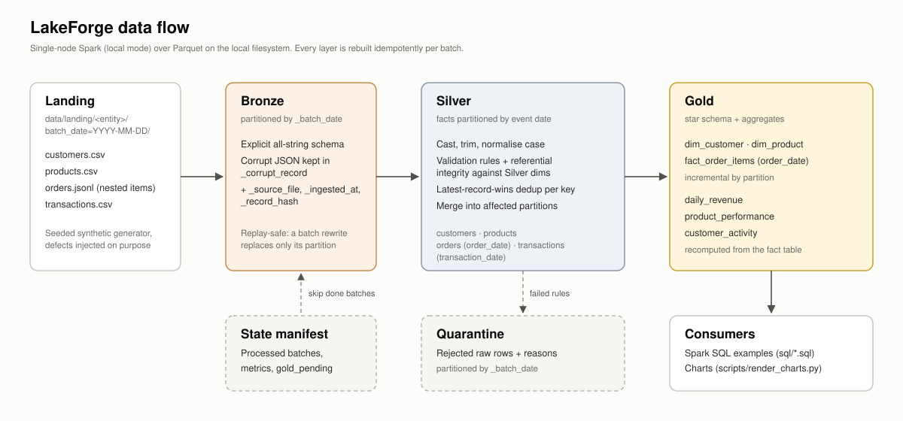
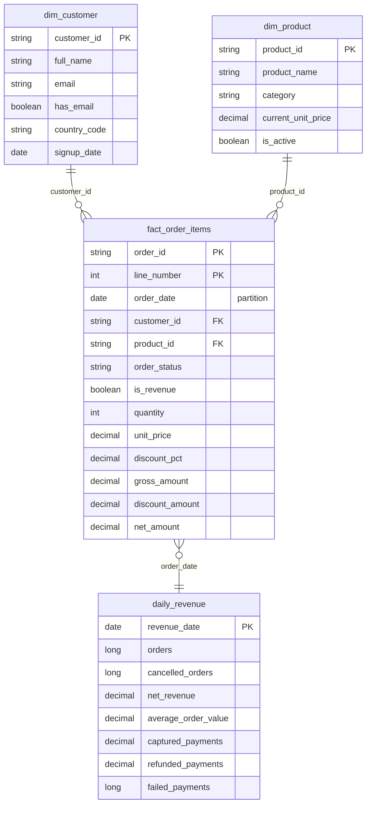
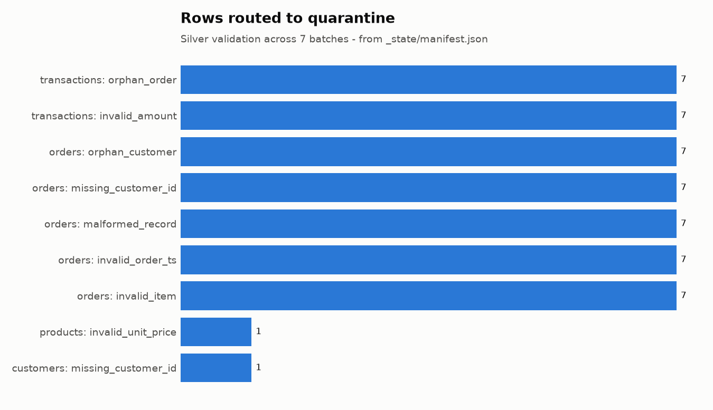
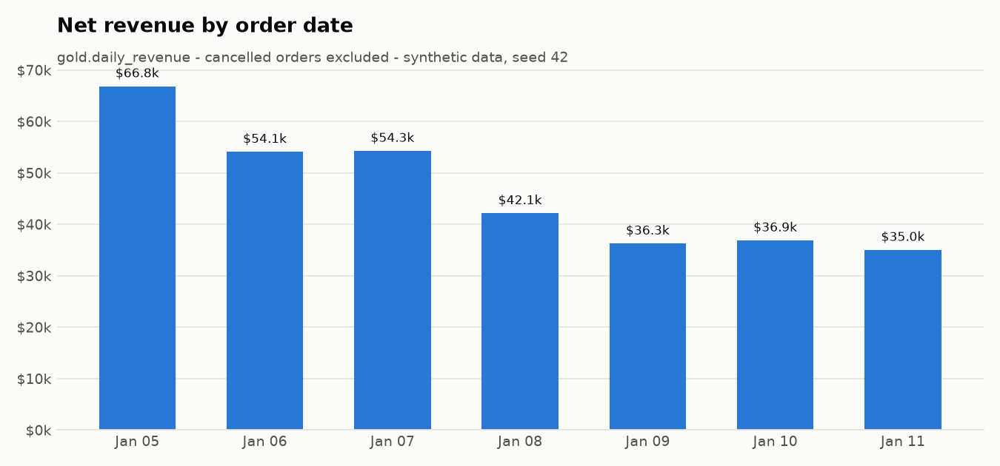

# LakeForge: Modern Data Lakehouse

LakeForge is a Bronze/Silver/Gold lakehouse pipeline built with PySpark and Parquet for a
fictional online marketplace. It ingests daily customer, product, order and payment
extracts, validates and deduplicates them, and publishes an analytics-ready star schema
with business aggregates.

> **Scope.** This is a production-inspired portfolio project, not a production system.
> It runs Spark in local mode on a single machine against a few thousand synthetic rows.
> The design choices (explicit schemas, quarantine, idempotent partition rewrites,
> incremental state) are the ones a real platform needs; the scale, storage layer and
> orchestration are deliberately minimal. See [Limitations](#limitations).



## Contents

- [Business problem](#business-problem)
- [Architecture](#architecture)
- [Data model](#data-model)
- [Design decisions](#design-decisions)
- [Partitioning strategy](#partitioning-strategy)
- [Incremental processing and idempotency](#incremental-processing-and-idempotency)
- [Data-quality rules](#data-quality-rules)
- [Getting started](#getting-started)
- [Results from a local run](#results-from-a-local-run)
- [Testing](#testing)
- [Project structure](#project-structure)
- [Limitations](#limitations)
- [Future improvements](#future-improvements)

## Business problem

The marketplace receives one extract per entity per day from its operational systems:

| Entity | Format | Notes |
| --- | --- | --- |
| customers | CSV | New sign-ups plus profile changes (CDC-style deltas) |
| products | CSV | New listings plus price changes |
| orders | JSON Lines | One order per line with a nested `items` array; status changes re-send the whole order |
| transactions | CSV | Payment attempts: `captured`, `failed`, `refunded` |

The extracts are not clean. They contain exact duplicates, orders that reference
customers that do not exist, malformed JSON lines, unparseable timestamps and amounts,
inconsistent casing and whitespace, and orders that arrive a day late. Analysts need
trustworthy daily revenue, product performance and customer activity, and the pipeline
must be safe to rerun after a failure or when an upstream system re-delivers a file.

### About the data

All data is **synthetic**. `lakeforge generate` produces it with a seeded random generator
(`src/lakeforge/ingestion/generator.py`). Each batch depends only on `(seed, day_index)`,
so the same command always writes byte-identical files. Defects are injected on
purpose and at fixed rates so that the Silver layer has real work to do. Names are drawn
from a small list, and email addresses use the reserved `example.com` and `example.org`
domains. None of it describes real people, products or companies.

## Architecture

| Layer | Responsibility | Storage | Write mode |
| --- | --- | --- | --- |
| **Landing** | Raw files as delivered | `data/landing/<entity>/batch_date=YYYY-MM-DD/` | Written by the generator |
| **Bronze** | Preserve every landed row for traceability and replay. No business rules. | Parquet, partitioned by `_batch_date` | Replace the batch's partition |
| **Silver** | Typed, standardized, validated, deduplicated entities with referential integrity | Parquet; facts partitioned by event date | Merge into the affected partitions |
| **Quarantine** | Rows that failed Silver validation, kept raw with the reasons | Parquet, partitioned by `_batch_date` | Replace the batch's partition |
| **Gold** | Star schema and business aggregates | Parquet; fact partitioned by `order_date` | Fact: affected partitions. Aggregates: full rebuild |

**Bronze** reads every field as a string, using an explicit schema. A value like
`amount = "N/A"` stays visible as it was delivered instead of being turned into a silent
`null` by type inference. Malformed JSON lines are captured in `_corrupt_record`. Each
row gets `_source_file`, `_ingested_at`, a SHA-256 `_record_hash` of its business fields,
and `_batch_date`.

**Silver** does the following:

1. Trims whitespace and normalizes case (emails lower-case, IDs and country codes
   upper-case).
2. Casts with `try_cast`/`try_to_timestamp`, so bad values become detectable nulls rather
   than job failures under Spark 4's ANSI mode.
3. Evaluates named rules and routes failing rows to quarantine with every reason that
   applied.
4. Upserts the passing rows, keeping the latest record per business key.

Orders are validated against the Silver customer and product tables. Transactions are
validated against Silver orders.

**Gold** builds `dim_customer`, `dim_product` and `fact_order_items` (one row per order
line), plus three aggregates: `daily_revenue`, `product_performance` and
`customer_activity`.

## Data model



| Gold table | Grain | Key metrics |
| --- | --- | --- |
| `fact_order_items` | order line | gross, discount and net amount; `is_revenue` excludes cancelled orders |
| `daily_revenue` | calendar day | orders, cancellations, units, gross/net revenue, AOV, captured/refunded/failed payments |
| `product_performance` | product | units, orders, buyers, net revenue, revenue rank, share of category revenue |
| `customer_activity` | customer | orders, lifetime net revenue, AOV, first/last order, active days, recency, segment |

Money is stored as `DECIMAL(12,2)` in Silver and `DECIMAL(18,2)` in Gold aggregates.
Floating point is never used for currency. Line net amounts are rounded per line,
matching how the source system computes payment totals.

## Design decisions

**PySpark DataFrames.** All transformations are DataFrame expressions: window functions
for deduplication, higher-order functions (`transform`, `exists`) to type and validate
nested order items without exploding them, and joins for referential integrity. No Python
UDFs are used, so Spark can optimize the whole plan.

**Parquet.** Columnar Parquet with Snappy compression keeps types (including decimals and
nested arrays) and supports partition pruning. Bronze is also Parquet instead of a copy of
the raw files: the raw values are still strings, but downstream reads are typed, columnar
and partition-pruned.

**Explicit schemas.** Every read declares its schema (`src/lakeforge/schemas.py`). Schema
inference would make the pipeline's behavior depend on the data it happened to see.

**Staged writes.** Silver and Gold merges read the partitions they are about to replace,
and Spark refuses to overwrite a path that the same plan reads from. Every write
therefore goes to `data/_staging/` first, and partition directories are then swapped in
with a rename (`src/lakeforge/storage/parquet.py`).

**Why not dbt.** The transformations here need nested-array handling, quarantine routing
and partition-level merges driven by a state manifest. These are imperative concerns that
dbt-spark would push into macros and pre/post hooks. With a single engine and no
warehouse, dbt would add a second toolchain without adding lineage or tests that pytest
does not already provide. The `sql/` folder shows the same Gold tables queried with
plain Spark SQL.

**Why not Delta Lake or Iceberg.** A table format would provide ACID commits, `MERGE` and
time travel, and it is the obvious next step (see
[Future improvements](#future-improvements)). This project uses plain Parquet on purpose,
so that the idempotency and merge logic is visible and tested rather than delegated.

## Partitioning strategy

| Table | Partition column | Why |
| --- | --- | --- |
| Bronze (all entities) | `_batch_date` | Replaying a batch rewrites exactly one partition. It also matches how data arrives. |
| Quarantine | `_batch_date` | Reprocessing a batch replaces its rejected rows instead of appending to them. |
| `silver/orders` | `order_date` | Analytical queries filter on when the order happened, not when it was delivered. |
| `silver/transactions` | `transaction_date` | Same reasoning, for payment reconciliation. |
| `gold/fact_order_items` | `order_date` | Allows incremental rebuilds and date pruning. |
| Dimensions and aggregates | none | Small enough that one file beats many tiny ones. |

**Trade-offs.**

- **Event date vs. arrival date.** Partitioning facts by event date means a late order,
  or a status update to an old order, reopens an older partition. The pipeline handles
  this by computing the set of affected partitions per batch. The manifest records it as
  `order_dates_touched`; in the sample data most batches touch two or three dates.
  Partitioning by arrival date would make writes append-only but would force every
  date-filtered query to scan everything.
- **Daily granularity.** At roughly 80 orders per day, the partitions are far smaller
  than the ~128 MB a production layout would target. The local run produces one Parquet
  file per partition, which is reasonable here. At higher volume this would become a
  small-files problem, and the right granularity might be monthly or a bucketed layout.
- **No partitioning for dimensions.** Customers and products are rewritten in full on
  every upsert. That is cheap at hundreds of rows and would need a table format with
  `MERGE` at millions.

## Incremental processing and idempotency

`data/_state/manifest.json` records every processed batch together with its row counts,
rejection reasons, post-write check results and the order dates it touched. A run
processes each batch through these steps:

1. **Discover** batches for which all four entities have landed. Incomplete batches are
   skipped with a warning naming the missing entity.
2. **Skip** batches already in the manifest, unless `--reprocess DATE` or
   `--full-refresh` is given.
3. **Bronze.** Replace the `_batch_date` partition.
4. **Silver dimensions.** Union the existing table with the batch's valid rows, keep the
   latest row per key, and rewrite the table.
5. **Silver facts.** Find the affected partitions: the event dates of the new rows plus
   the dates where existing versions of the same keys live. Read only those partitions,
   union them with the new rows, deduplicate, and replace exactly those partitions.
6. **Post-write checks.** Unique keys, non-null required columns, and orders → customers,
   items → products and transactions → orders integrity. A failure stops the run before
   the batch is recorded.
7. **Record** the batch and add its touched dates to `gold_pending`, then save the
   manifest atomically (write a temp file, then rename).
8. **Gold.** Rebuild `fact_order_items` for the pending dates, recompute the aggregates,
   run Gold checks, and clear `gold_pending`. If Gold fails, the pending dates survive
   in the manifest and the next run retries them even when there are no new batches.

**Why reruns are safe.**

- Every write replaces a well-defined set of partitions instead of appending.
- Deduplication is deterministic. Within a key the winner is chosen by business
  timestamp, then batch date, then record hash. Reprocessing an old batch after newer
  ones therefore cannot roll a customer's email or an order's status backwards.
- The test suite checks this directly. Rerunning with no new data leaves every Silver and
  Gold table row-for-row identical. Reprocessing a batch does the same. Adding
  a third day incrementally produces exactly the same tables as a full refresh over all
  three days. See `tests/test_pipeline.py`.

**Known gap.** The swap from staging into place renames one directory per partition.
Each rename is atomic, but a crash between two renames can leave a table with some
partitions from the new version and some from the old. Rerunning the same batch repairs
this, because the merge is idempotent. A table format would make the commit atomic.

## Data-quality rules

Rows that violate any rule are written to `data/quarantine/<entity>/` with the raw values
and a `_rejection_reasons` array. Rules are defined in
`src/lakeforge/transformations/silver.py`.

| Entity | Rule | Null-handling policy |
| --- | --- | --- |
| customers | `missing_customer_id`, `invalid_customer_id` (`C` + 6 digits), `invalid_email` (only if present), `invalid_country_code`, `invalid_signup_date`, `invalid_updated_at` | Missing email is allowed and kept as `null` (`has_email = false` in Gold). Missing country becomes `ZZ` (unknown). |
| products | `missing_product_id`, `invalid_product_id`, `missing_product_name`, `invalid_unit_price` (non-numeric or negative), `invalid_is_active`, `invalid_updated_at` | Missing category becomes `uncategorized`. |
| orders | `malformed_record` (short-circuits all other rules), `missing_order_id`, `invalid_order_id`, `missing_customer_id`, `invalid_order_ts`, `invalid_status`, `invalid_updated_at`, `empty_items`, `invalid_item` (bad product id, quantity ≤ 0, negative price, discount outside [0, 1)), `orphan_customer`, `orphan_product` | An order is accepted or rejected as a whole, so revenue is never computed from a partial basket. |
| transactions | `missing_transaction_id`, `invalid_transaction_id`, `missing_order_id`, `invalid_transaction_ts`, `invalid_payment_method`, `invalid_amount` (non-numeric or ≤ 0), `unsupported_currency`, `invalid_status`, `orphan_order` | Currency is upper-cased before the check, so `usd` is accepted. |

Exact and key-level duplicates are not rejected. They are collapsed by the
latest-record-wins merge, and the number collapsed within each batch is recorded as
`duplicates_in_batch`.

**Orphan policy.** An order that references an unknown customer is quarantined rather than
loaded with a placeholder dimension row. If the customer arrives later, the order can be
reloaded with `lakeforge run --reprocess <batch date>`. Automatic re-evaluation of
quarantined rows is listed under future improvements.

## Getting started

### Requirements

| Option | Needs |
| --- | --- |
| Docker (recommended) | Docker with Compose v2. The image bundles Python 3.12, OpenJDK 17 and Spark. |
| Local | Python 3.12 or 3.13, Java 17 or 21 on `PATH` (required by Spark 4), GNU Make |

No cloud account, credentials or paid service is needed. Dependency versions are pinned
in `pyproject.toml`: `pyspark==4.0.1`, plus `pytest`, `ruff` and `matplotlib` within
tested ranges.

### With Docker

```bash
make docker-build      # build the image
make docker-demo       # generate 7 days, run the pipeline, run the SQL examples
make docker-test       # lint + full test suite inside the container
```

The repository is mounted into the container, so outputs appear under `./data`.

### Locally

```bash
make install           # creates .venv and installs the package with dev + docs extras
make generate DAYS=7   # write synthetic landing data
make pipeline          # process all new batches
make sql               # run sql/*.sql against Gold
make report            # per-batch data-quality metrics as JSON
make charts            # re-render docs/images from the current Gold output
```

The equivalent CLI commands:

```bash
lakeforge generate --days 7 --seed 42
lakeforge run                                   # incremental
lakeforge run --reprocess 2026-01-06            # force one batch again
lakeforge run --full-refresh                    # rebuild every layer from landing
lakeforge generate --days 1 --first-day-index 7 # deliver the next day, then: lakeforge run
lakeforge sql sql/02_rolling_revenue.sql
```

`spark-submit jobs/run_pipeline.py` and `spark-submit jobs/run_sql.py <file>` run the same
code through `spark-submit`.

Configuration is read from environment variables (see `.env.example`):
`LAKEFORGE_DATA_DIR`, `LAKEFORGE_SPARK_MASTER`, `LAKEFORGE_SHUFFLE_PARTITIONS`,
`LAKEFORGE_LOG_LEVEL` and `LAKEFORGE_SPARK_LOG_LEVEL`. Docker Compose picks up a `.env`
file automatically. For local runs, export the variables in your shell.

## Results from a local run

Everything below was produced by `make docker-demo` (7 days, seed 42). It ran on a macOS host
with Docker Desktop limited to 8 CPUs and about 4 GB of memory. With a different seed or day
count the numbers will change.

**Volumes.** Bronze received 1,305 rows across the 7 batches. After validation and
deduplication, Silver holds 168 customers, 43 products, 478 orders and 459 transactions.
Gold `fact_order_items` has 1,219 order lines.

**Quarantine.** Every daily batch rejects 5 order rows and 2 transaction rows. The first
batch also rejects one customer with no ID and one product with a non-numeric price. Two
duplicate orders, one duplicate transaction and one duplicate customer are collapsed in
each batch. All post-write integrity checks reported 0 failing rows.



**Daily revenue** (`gold.daily_revenue`). The downward drift is an artifact of the random
draws in the generator, not a modeled trend.



**Runtime.** In that container, the first full run over 7 batches took about 95 seconds of
wall-clock time. Almost all of it is per-job Spark overhead for many small writes: each
batch performs about a dozen small Parquet writes plus count actions. This is not a
throughput benchmark, and no performance claim is made beyond it.

**SQL examples.** Excerpt of `sql/04_customer_segments.sql`:

```text
+---------+---------+------+-----------+--------------+---------------+
|segment  |customers|orders|net_revenue|pct_of_revenue|avg_order_value|
+---------+---------+------+-----------+--------------+---------------+
|repeat   |95       |266   |205768.52  |63.2          |758.12         |
|loyal    |21       |121   |97504.51   |30.0          |805.21         |
|one_time |29       |29    |22185.50   |6.8           |765.02         |
|no_orders|23       |0     |0.00       |0.0           |0.00           |
+---------+---------+------+-----------+--------------+---------------+
```

| File | Technique |
| --- | --- |
| `01_top_products_by_revenue.sql` | Ranking with category revenue share |
| `02_rolling_revenue.sql` | Moving average and day-over-day change with window functions |
| `03_category_daily_mix.sql` | `PIVOT` of daily revenue by category |
| `04_customer_segments.sql` | Segment mix and revenue concentration |
| `05_revenue_by_country.sql` | Fact–dimension join |
| `06_payment_reconciliation.sql` | Recognised revenue vs. net captured cash per day |

## Testing

```bash
make test         # all tests, including end-to-end pipeline runs
make test-unit    # skips tests marked "integration"
make lint         # ruff check + ruff format --check
```

| File | Covers |
| --- | --- |
| `test_generator.py` | Determinism, regeneration of a single day, file layout and headers, injected defects, ID continuity, late arrivals, payment totals |
| `test_bronze.py` | Batch discovery, row preservation including corrupt lines, metadata columns, partition layout, idempotent re-ingest, actionable errors |
| `test_silver.py` | Standardization, null handling, every rejection rule, nested item typing, referential integrity, deterministic deduplication |
| `test_gold.py` | Line amounts, cancelled-order exclusion, daily revenue and payments, product ranking and share, customer segments |
| `test_storage.py` | Partition replacement, clearing stale partitions, read-and-rewrite of the same partition, manifest round-trip and corruption handling |
| `test_pipeline.py` | No-op reruns, idempotent reprocessing, incremental equals full refresh, status updates, partition correctness, recorded quality metrics |

**Latest result** (inside the Docker image, Python 3.12.15, Java 17, PySpark 4.0.1):

```text
$ make lint
All checks passed!
34 files already formatted

$ make test
41 passed in 157.91s (0:02:37)

$ make test-unit
35 passed, 6 deselected in 45.94s
```

## Project structure

```text
.
├── src/lakeforge/
│   ├── cli.py                 # generate | run | sql | report
│   ├── pipeline.py            # batch discovery, manifest, layer orchestration
│   ├── config.py              # environment-driven settings
│   ├── spark.py               # SparkSession configuration
│   ├── schemas.py             # explicit schemas for every layer
│   ├── ingestion/
│   │   ├── generator.py       # deterministic synthetic marketplace data
│   │   └── bronze.py          # landing → Bronze
│   ├── transformations/
│   │   ├── silver.py          # standardization, rules, merges
│   │   └── gold.py            # star schema and aggregates
│   ├── quality/
│   │   ├── rules.py           # row-level rules and quarantine split
│   │   └── checks.py          # post-write table checks
│   └── storage/
│       ├── parquet.py         # staged, partition-scoped writes
│       └── state.py           # batch manifest
├── jobs/                      # spark-submit entry points
├── sql/                       # analytical queries over Gold
├── scripts/render_charts.py   # charts in docs/images from real output
├── tests/
├── docs/images/
├── data/                      # generated; only data/README.md is tracked
└── Dockerfile, docker-compose.yml, Makefile, pyproject.toml
```

## Limitations

- **Single node.** Spark runs in `local[*]` mode. Nothing has been tested on a cluster,
  and the dataset is a few thousand rows. The code uses no driver-side data paths except
  collecting small sets of partition dates, but cluster behavior has not been measured.
- **Local filesystem, plain Parquet.** There are no ACID transactions, concurrent writers
  are not supported, and the partition swap is not atomic across partitions. Object
  storage (S3, GCS) would need a different commit strategy, because rename is not atomic
  there.
- **Merge cost.** Finding which existing fact partitions hold an incoming key scans the
  key column of the whole Silver fact table. That is fine at this size; at scale it needs
  an index, a key-to-partition lookup, or a table format with `MERGE`.
- **Dimensions are SCD type 1.** Profile and price history are overwritten, so historical
  revenue uses the price on the order line and the current product attributes.
- **Gold aggregates are recomputed in full** on every run that changes data.
- **Quarantined orders are not retried automatically** when a late dimension row arrives.
- **Synthetic data only.** The defects are the ones the generator injects; real feeds
  will fail in ways these rules do not anticipate.
- **No orchestration or alerting.** Runs are triggered by `make` or the CLI.

## Future improvements

- Store Silver and Gold as Delta Lake or Apache Iceberg tables to get atomic commits,
  `MERGE INTO` and time travel.
- Automatically re-evaluate quarantined rows when their missing parent arrives.
- Add SCD type 2 history for customers and products.
- Incrementally maintain `daily_revenue` by partition instead of recomputing it.
- Orchestrate with Airflow or Dagster, using the batch manifest as the sensor.
- Publish data-quality metrics to a monitoring backend and alert on rejection-rate spikes.
- Run against object storage with a distributed Spark cluster and measure real
  throughput.

## License

[MIT](LICENSE)
